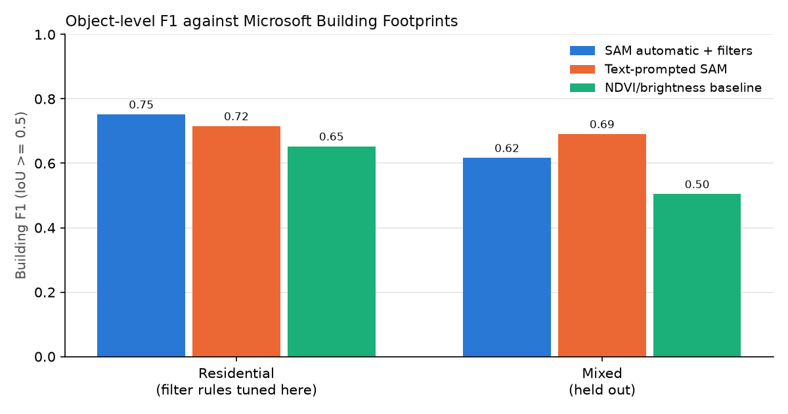
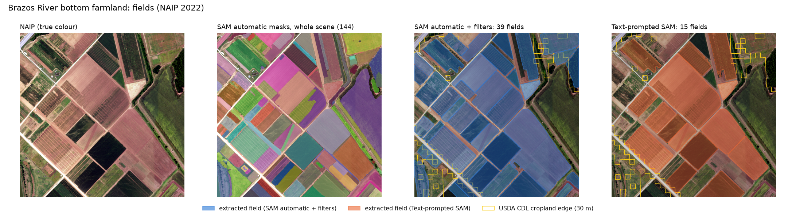
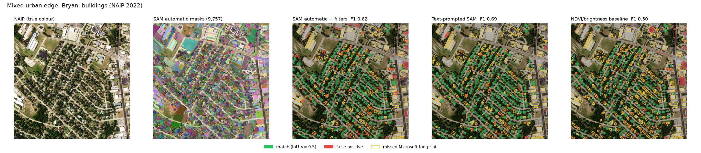

# Segment Anything on aerial imagery: buildings and fields from NAIP, with measured accuracy

Meta's Segment Anything Model (SAM) is used here to pull building footprints and farm fields out of 0.6 m USDA NAIP imagery around Bryan–College Station, Texas, with no training labels. Every output is checked against independent reference data (Microsoft Building Footprints and the USDA Cropland Data Layer) and compared with a simple NDVI/brightness threshold baseline, so the numbers show what SAM adds and where it falls short.

## Summary

- **Question:** Can Segment Anything (SAM), with no training labels, map buildings and fields in 0.6 m NAIP imagery better than a simple NDVI/brightness threshold?
- **Answer:** On the mixed area held out from tuning, text-prompted SAM scored building F1 0.69 (95% CI 0.62–0.74), against 0.50 (0.42–0.57) for the baseline (F1 balances precision and recall).
- **Main limitation:** Three squares of about 1 km² in one county show how the approach behaves, not a general accuracy.


*Held-out Bryan neighbourhood (zoomed): NAIP on the left; text-prompted SAM footprints (colour) and Microsoft footprints (white outlines) on the right.*

## My role

I'm a geographer: B.S. in Geography with a GIS background, now an M.S. Geography student at Texas A&M. I ran this project as the human on the loop. I owned the question, the standards and every decision about what gets published, and used Claude Code (Anthropic) as the programmer.

- **Problem framing:** I defined the question, approved the study area and data, and set what a useful, defensible answer looks like.
- **Standards:** spatially held-out validation where the data allow, methods grounded in peer-reviewed literature, honest uncertainty (intervals and stated limitations), and a stated cost for every design choice.
- **Oversight at every stage:** I reviewed the plan, the intermediate results, the figures and the write-up, challenged anything unclear or unsupported, and sent work back until it met the standard.
- **Quality control:** before publishing, every number was traced to the project's results, the references checked and the tests run. The final call on what is reported, and what is stated as a limitation, is mine.

Commits made with Claude Code carry its `Co-Authored-By` line.

## Results

Three areas of about 1 km² each, NAIP 2022 (June 12, 2022), RTX 4080. Building scores are object-level: a prediction counts as correct when it overlaps a Microsoft footprint at IoU ≥ 0.5, with one-to-one matching. The 95% confidence intervals come from a block bootstrap (Künsch, 1989) applied in space: each square is cut into 5 × 5 blocks of 200 m, and the blocks are resampled 2,000 times. Resampling blocks rather than single buildings keeps neighbours that share errors together, such as canopy, roof type or reference vintage.

**Buildings vs. Microsoft Building Footprints**

| Area | Method | Predicted | Reference | Precision | Recall | **F1** | F1 95% CI | Mean IoU of matches | Pixel IoU | Area ratio (pred/ref) |
|---|---|---:|---:|---:|---:|---:|---:|---:|---:|---:|
| Residential (rules tuned here) | SAM automatic + filters | 637 | 645 | 0.76 | 0.75 | **0.75** | 0.71–0.79 | 0.70 | 0.54 | 0.85 |
| | Text-prompted SAM | 434 | 645 | 0.89 | 0.60 | **0.72** | 0.67–0.76 | 0.71 | 0.46 | 0.69 |
| | NDVI/brightness baseline | 553 | 645 | 0.71 | 0.61 | **0.65** | 0.60–0.70 | 0.68 | 0.44 | 0.60 |
| Mixed (held out from tuning) | SAM automatic + filters | 407 | 423 | 0.63 | 0.61 | **0.62** | 0.54–0.68 | 0.71 | 0.39 | 0.63 |
| | Text-prompted SAM | 289 | 423 | 0.85 | 0.58 | **0.69** | 0.62–0.74 | 0.71 | 0.39 | 0.53 |
| | NDVI/brightness baseline | 338 | 423 | 0.57 | 0.45 | **0.50** | 0.42–0.57 | 0.68 | 0.29 | 0.44 |



What the numbers say:

- **Text-prompted SAM held up best on new ground.** On the held-out mixed area it scored F1 0.69 (95% CI 0.62–0.74), against 0.62 (0.54–0.68) for automatic SAM and 0.50 (0.42–0.57) for the baseline. Its interval does not overlap the baseline's. It does overlap automatic SAM's, so the order of the two SAM variants is not firm in a 1 km² sample. When it calls something a building it is usually right (precision 0.85–0.89), but it misses about 40% of the footprints.
- **Automatic SAM depends on the filters.** The model produced 11,368 masks in the residential area (roofs, trees, lawns, driveways and road pieces). On their own those masks are useless as building maps. The NDVI, brightness, shape and score rules bring F1 to 0.75, but they were tuned on this same area. On the held-out area automatic SAM fell to 0.62.
- **A tuned spectral baseline is a fair opponent.** With the same tuned thresholds, plain NDVI plus brightness reached 0.65 in the area it was tuned on. That shows how much of the work NAIP's near-infrared band does. SAM's gain is largest on the held-out area (+0.11 to +0.19 F1), where adjacent roofs and driveways merge in the pixel baseline.
- **Footprint regularization is cosmetic here.** Changing near-rectangular masks to minimum rotated rectangles moved F1 by less than 0.01 (`ms_buildings_before_regularization` in `results/metrics.json`).

**Fields (agricultural area, Brazos River bottom)**

| Method | Fields extracted | Field area (ha) | vs. CDL cropland: pixel IoU | precision | recall |
|---|---:|---:|---:|---:|---:|
| SAM automatic (whole scene) + shape filters | 39 | 64.6 | 0.63 | 0.91 | 0.67 |
| Text-prompted SAM ("rectangular field.") | 15 | 42.4 | 0.48 | 1.00 | 0.48 |

The CDL marks 88.1 ha of this square as cropland. Nearly everything SAM outlines as a field is cropland in the CDL (precision 0.91–1.00). The lower recall comes mostly from narrow strips, field edges and the 30 m CDL grid, which counts farm roads and ditches as crop. The reference is weak, so read the field numbers as agreement with the CDL, not as accuracy. There is only one field square and no held-out field area, so the field rules and prompt settings were never tested on new ground. A visual check of `figures/agricultural_fields.png` shows that automatic SAM separates most individual fields and plot blocks. Text-prompted SAM finds fewer, larger fields and sometimes merges neighbouring fields into one polygon.



**Runtime** (RTX 4080 16 GB, SAM ViT-H, full pipeline for all three areas: **317 s**):

| Step | Seconds |
|---|---:|
| Load SAM ViT-H + Grounding DINO | 10.6 |
| SAM automatic, buildings (25 tiles of 512 px), residential / mixed | 124.0 / 111.4 |
| Text-prompted SAM, buildings, residential / mixed | 15.9 / 15.5 |
| NDVI baseline, buildings, residential / mixed | 0.7 / 0.5 |
| SAM automatic, fields (whole scene) / text-prompted fields | 37.0 / 1.1 |

Text-prompted SAM runs about 7–8× faster than automatic SAM because it decodes masks only for the boxes Grounding DINO returns, not for a 32 × 32 grid of point prompts.

Per-area panels: [residential](figures/residential_buildings.png), [mixed](figures/mixed_buildings.png).



## Decisions

- **I tuned on one square and scored on another.** The building thresholds were chosen by grid search on the residential square only. The mixed square was seen once before tuning, so it is held out from tuning, not unseen. The cost is that one square sets every threshold.
- **I compared SAM with a tuned NDVI/brightness baseline.** The baseline gets the same thresholds and shape rules, so SAM's gain (+0.11 to +0.19 F1 on the held-out square) is measured, not assumed.
- **I used a spatial block bootstrap for the intervals.** Blocks of 200 m are resampled 2,000 times instead of single buildings, so neighbours that share errors stay together.
- **I scored against Microsoft footprints, not OpenStreetMap.** OSM has only 7 and 35 buildings in the two squares. The cost is a reference that was itself made by a model.
- **I tiled the scene for automatic SAM.** Tiles of 512 px are upsampled to 1024 px so 10–20 m houses are large enough to segment. The cost is about 2 minutes per square.
- **I report fields as agreement with the CDL, not accuracy.** There is one field square, the reference is a 30 m grid, and I changed the field prompt once after the first returned no usable boxes.

## Method

1. **Imagery.** The pipeline searches the Planetary Computer STAC `naip` collection (signed URLs), keeps the most recent year (2022) and mosaics it onto a fixed 0.6 m UTM 14N grid of about 1 km per AOI. All four bands (R, G, B, NIR) are kept.
2. **SAM automatic masks** (`segment-anything`, ViT-H). Buildings: the scene is cut into 512 px tiles with 128 px overlap. SAM upsamples each tile to 1024 px, which makes 10–20 m houses large enough to segment. Masks cut off by an interior tile edge are dropped, since the overlapping tile sees them whole. Fields: one pass over the whole scene.
3. **Text-prompted SAM.** Grounding DINO (`IDEA-Research/grounding-dino-base` through Hugging Face `transformers`) finds boxes for `"building. house. roof."` or `"rectangular field."`, and each box prompts SAM for a mask. samgeo's LangSAM and ArcGIS's Text SAM work the same way.
4. **Filters: turning generic masks into building or field candidates.** For each mask the pipeline computes its area, rectangularity (area ÷ minimum rotated rectangle), elongation, solidity, mean NDVI, mean brightness and SAM score. It keeps masks inside fixed bounds (`BUILDING_RULES` / `FIELD_RULES` in `samnaip/postprocess.py`). Text-prompted SAM and the baseline pass through the same building rules, minus the SAM-score bound. Greedy non-maximum suppression then removes duplicates and nested roof facets.
5. **Regularization and vectorization.** Masks are converted to polygons with `rasterio.features.shapes`. Near-rectangular roofs (rectangularity ≥ 0.85) become minimum rotated rectangles, and other roofs get a 0.9 m Douglas–Peucker simplification.
6. **Baseline.** Pixels with low NDVI and roof-like brightness are cleaned with a morphological opening and closing, grouped into connected components, and passed through the same shape rules.
7. **Evaluation** (`samnaip/evaluate.py`). Predictions are matched one-to-one to reference footprints by greedy IoU, from P/R/F1 at IoU ≥ 0.5. The pipeline also computes the mean IoU of matched pairs, pixel IoU/precision/recall on the 0.6 m grid, and the ratio of total predicted to reference area. Predictions and references are treated the same way at the edge: an object counts toward an AOI only if its centroid falls inside the square. Predictions come from masks inside the raster, so the rule removes none of them. The 21 (residential) and 14 (mixed) reference footprints that straddle the edge are kept whole, but a prediction can only cover their inside part. That is a small bias, the same for every method. Object F1 also gets a spatial block-bootstrap 95% CI, as described under Results.

**Tuning protocol: what was chosen where.**

- **Chosen with a small grid search on the residential square only:** the building filter thresholds (NDVI ≤ −0.15, brightness 90–165, rectangularity ≥ 0.60, elongation ≤ 3, solidity ≥ 0.75, area ≥ 40 m², SAM score ≥ 0.90) and the baseline's pixel thresholds.
- **Set before any results and never tuned:**
  - SAM generator settings (32 × 32 points, predicted-IoU 0.86, stability 0.90, 512 px tiles with 128 px overlap)
  - the building prompt `"building. house. roof."` with Grounding DINO box/text thresholds 0.25/0.20 and a maximum box size of half the tile
  - the NMS overlap of 0.5
  - the 6,000 m² area cap
  - the regularization settings (rectangle at rectangularity ≥ 0.85, otherwise 0.9 m simplification)
- **Exactly what was seen of the mixed square:**
  - The three squares were picked from a true-colour quicklook before any segmentation.
  - Automatic SAM was run on the mixed square once *before* tuning, with the first loose rules, and its score was printed (F1 0.25 against Microsoft footprints).
  - After the rules were fixed, regularization thresholds were compared on both squares, and the preset default was kept.
  - No setting was changed in response to mixed-square numbers.
  - "Held out" therefore means held out from tuning, not unseen.
- **Fields:** there is only one field square, so nothing there is held out. The field prompt was changed from `"agricultural field."` to `"rectangular field."`, with box/text thresholds lowered to 0.15. The reason was that the first prompt returned no usable boxes on this square: Grounding DINO boxed the whole scene.

NDVI here comes from NAIP digital numbers, not reflectance, so roofs fall well below zero. The NDVI thresholds will not transfer to other NAIP years or states without re-checking.

## How to run

```bash
conda env create -f environment.yml        # PyTorch CUDA 12.4 wheels; swap the index URL for CPU-only
conda activate geoai-sam

# official SAM ViT-H checkpoint from Meta (2.4 GB; MD5 4b8939a88964f0f4ff5f5b2642c598a6)
mkdir -p data/weights
curl -L -o data/weights/sam_vit_h_4b8939.pth https://dl.fbaipublicfiles.com/segment_anything/sam_vit_h_4b8939.pth

python run.py                                    # all three AOIs, all methods (~6 min on an RTX 4080)
python run.py --aoi residential --method auto    # one AOI, one method
python run.py --bbox -96.305 30.580 -96.292 30.590 --name my_area
python run.py --reuse                            # re-run filters/evaluation on cached masks (seconds)
pytest -q                                        # fast CPU tests: IoU matching, filters, raster/vector alignment
```

Grounding DINO weights download from Hugging Face on first use. Imagery, reference downloads, weights and cached masks go to `data/`, which is git-ignored. Outputs go to `figures/` and `results/`. The GeoJSON files are in EPSG:4326, and field outlines are simplified to 1 m to keep the files small.

```
samnaip/imagery.py      AOIs, NAIP mosaic, Microsoft footprints, OSM, CDL
samnaip/segment.py      SAM automatic, Grounding DINO + SAM, threshold baseline
samnaip/postprocess.py  mask -> polygon, filters, NMS, regularization
samnaip/evaluate.py     IoU matching, P/R/F1, pixel IoU, area agreement
samnaip/plots.py        panels, metrics chart, hero image
run.py                  command-line pipeline -> results/metrics.json, results/*.geojson, figures/
```

## Limitations

- **SAM is class-agnostic.** It segments everything, so "building" and "field" come from hand-set rules or from a text detector. The rules were tuned on one neighbourhood and lose about 0.13 F1 on the next. They also drop large, very bright commercial roofs (brightness > 165 or area > 6,000 m²). These show up as missed footprints along the commercial strip in the mixed-area panel.
- **Reference dates differ.** NAIP is from June 2022. The Microsoft footprints come from the 2022-07-06 global release, built from imagery of mixed dates. The CDL layer on the Planetary Computer is the **2021** crop year. New houses, demolitions and crop rotations all show up as "errors".
- **Reference footprints have errors of their own.** The Microsoft footprints were themselves extracted by a model and are sometimes offset, merged or missing. OpenStreetMap was also queried but has only 7 and 35 buildings mapped in these squares, too few to score against (they are counted in `metrics.json`). No OSM farmland polygons exist here. The field reference is the 30 m CDL, which is coarse.
- **Tree canopy.** Roofs under oak canopy, common in College Station, cannot be seen in leaf-on June imagery by any method. This limits recall.
- **Small sample.** There are three squares of about 1 km² in one county, from one NAIP acquisition. The results show how the approach behaves; they do not support a general accuracy claim.

## Esri equivalent

ArcGIS Pro and ArcGIS Online offer pretrained deep learning packages on ArcGIS Living Atlas for the same ideas: a Segment Anything Model package and a Text SAM package (text-prompted segmentation). Both run through ArcGIS Pro's deep learning geoprocessing tools, such as *Detect Objects Using Deep Learning*. This project is an open-source, scriptable version of that workflow with an explicit accuracy assessment. It has not been benchmarked against the Esri packages.

## References

- Kirillov, A., Mintun, E., Ravi, N., Mao, H., Rolland, C., Gustafson, L., Xiao, T., Whitehead, S., Berg, A. C., Lo, W.-Y., Dollár, P., & Girshick, R. (2023). Segment Anything. *Proceedings of the IEEE/CVF International Conference on Computer Vision (ICCV)*, 3992–4003. https://doi.org/10.1109/ICCV51070.2023.00371
- Liu, S., Zeng, Z., Ren, T., Li, F., Zhang, H., Yang, J., Jiang, Q., Li, C., Yang, J., Su, H., Zhu, J., & Zhang, L. (2024). Grounding DINO: Marrying DINO with grounded pre-training for open-set object detection. In *Computer Vision – ECCV 2024*, Lecture Notes in Computer Science (pp. 38–55). https://doi.org/10.1007/978-3-031-72970-6_3
- Wu, Q., & Osco, L. P. (2023). samgeo: A Python package for segmenting geospatial data with the Segment Anything Model (SAM). *Journal of Open Source Software*, 8(89), 5663. https://doi.org/10.21105/joss.05663
- Künsch, H. R. (1989). The jackknife and the bootstrap for general stationary observations. *The Annals of Statistics*, 17(3), 1217–1241. https://doi.org/10.1214/aos/1176347265
- USDA Farm Production and Conservation Business Center. National Agriculture Imagery Program (NAIP). Accessed through the Microsoft Planetary Computer.
- Microsoft. Global ML Building Footprints (https://github.com/microsoft/GlobalMLBuildingFootprints), ODbL. Accessed through the Microsoft Planetary Computer (`ms-buildings`).
- USDA National Agricultural Statistics Service. Cropland Data Layer. Accessed through the Microsoft Planetary Computer (`usda-cdl`).
- OpenStreetMap contributors. OpenStreetMap data via the Overpass API, ODbL 1.0.

## License

Code: MIT (see `LICENSE`). Model weights are not included and keep their own licenses: SAM code and checkpoints are Apache-2.0 (Meta), and Grounding DINO checkpoints are Apache-2.0 (IDEA-Research). Data: NAIP and CDL are USDA public-domain products. Microsoft Building Footprints and OpenStreetMap are ODbL 1.0, and OSM data is © OpenStreetMap contributors.
